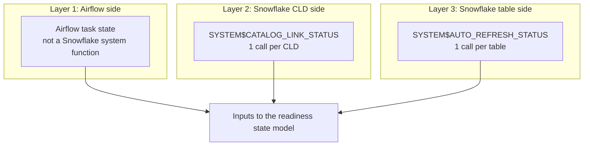

# CLD, Iceberg, and Airflow source signals

A quiet upstream cycle can succeed without creating a new Iceberg snapshot.
Readiness therefore uses three separate signals: Airflow task state, Snowflake
catalog-linked database (CLD) health, and Snowflake table auto-refresh health.

## Three-layer flow

## Part 1: Airflow delivery evidence

Airflow is a separate control plane. It has no Snowflake system function.

| Control | Example mapping | Scope for `N` tables | Evidence and pass condition |
|---|---|---|---|
| Table delivery | DAGs `replay_payments_hourly` and `replay_payments_daily`; task `validate_payments_payment_events` | One check per table-specific delivery task: `N` checks | The latest Airflow task instance state is `success`, and its successful `end_date` is no more than 26 hours old |

## Part 2: Snowflake Iceberg health

Snowflake exposes two system functions for the Iceberg side. `ICEBERG_PROD` is
the Snowflake CLD database object passed to `SYSTEM$CATALOG_LINK_STATUS`;
`PAYMENTS` is a schema, not an argument to that function.

| Layer | Native Snowflake function | Exact example statement | Scope for `N` tables in one CLD | Healthy result |
|---|---|---|---|---|
| 2. CLD link | `SYSTEM$CATALOG_LINK_STATUS` | `SELECT SYSTEM$CATALOG_LINK_STATUS('ICEBERG_PROD');` | Run once for the CLD | The returned JSON has `executionState = RUNNING` and an empty `failureDetails` array |
| 3. Table auto-refresh | `SYSTEM$AUTO_REFRESH_STATUS` | `SELECT SYSTEM$AUTO_REFRESH_STATUS('ICEBERG_PROD.PAYMENTS.PAYMENT_EVENTS');` | Run once for each table: `N` calls with `N` different table names | The returned JSON has `executionState = RUNNING`, no `invalidExecutionStateReason`, and an acceptable `pendingSnapshotCount` |

For `N` tables sourced through one CLD, run one CLD function call and `N` table
function calls. The CLD function is not repeated per table.

## Access requirements

- `SYSTEM$CATALOG_LINK_STATUS` requires `MONITOR` or `OWNERSHIP` on the CLD
  database.
- `SYSTEM$AUTO_REFRESH_STATUS` requires `OWNERSHIP` on the Iceberg table.

## dbt implementation

[`example_sources.yml`](models/example_sources.yml) registers the Airflow check
per table-to-task mapping, the CLD check once per CLD, and the table check once
per source table.

The Snowflake tests wrap the two native system functions:

- [`cld_catalog_link_status.sql`](tests/generic/cld_catalog_link_status.sql)
- [`iceberg_auto_refresh_status.sql`](tests/generic/iceberg_auto_refresh_status.sql)

The Airflow test remains separate from those Snowflake functions:

- [`airflow_task_freshness.sql`](tests/generic/airflow_task_freshness.sql)

For a stopped table auto-refresh pipe, follow
[`iceberg_auto_refresh_recovery.md`](iceberg_auto_refresh_recovery.md).
