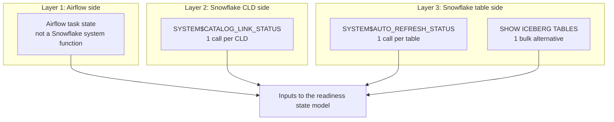

# CLD, Iceberg, and Airflow source signals

A quiet upstream cycle can succeed without creating a new Iceberg snapshot.
Readiness therefore uses three separate signals: Airflow task state, Snowflake
catalog-linked database (CLD) health, and Snowflake table auto-refresh health.

## Three-layer flow

## Native Snowflake functions and statements

Snowflake exposes two system functions for these checks;
`SHOW ICEBERG TABLES` is the optional bulk statement. `ICEBERG_PROD` is the
Snowflake CLD database object passed to `SYSTEM$CATALOG_LINK_STATUS`; `PAYMENTS`
is a schema, not an argument to that function.

| Layer | Native function or statement | Exact example | Scope for 150 tables in one CLD | Healthy result |
|---|---|---|---|---|
| 2. CLD link | `SYSTEM$CATALOG_LINK_STATUS` | `SELECT SYSTEM$CATALOG_LINK_STATUS('ICEBERG_PROD');` | Run once for the CLD | The returned JSON has `executionState = RUNNING` and an empty `failureDetails` array |
| 3. One table | `SYSTEM$AUTO_REFRESH_STATUS` | `SELECT SYSTEM$AUTO_REFRESH_STATUS('ICEBERG_PROD.PAYMENTS.PAYMENT_EVENTS');` | Run once for each table: 150 calls with 150 different table names | The returned JSON has `executionState = RUNNING`, no `invalidExecutionStateReason`, and an acceptable `pendingSnapshotCount` |
| 3. Bulk alternative | `SHOW ICEBERG TABLES` | `SHOW ICEBERG TABLES IN DATABASE ICEBERG_PROD;` | Run once; inspect the `auto_refresh_status` value returned for each visible table | Every expected table appears, and each `auto_refresh_status` payload satisfies the table condition above |

For 150 tables sourced through one CLD, the CLD function is called once. The
table layer is either 150 `SYSTEM$AUTO_REFRESH_STATUS` calls, each for a
different table, or one `SHOW ICEBERG TABLES` statement. `SHOW` returns only
tables visible to the current role, so its result must be reconciled to the
expected table registry.

Airflow does not have an equivalent Snowflake system function. Its task state is
external orchestration evidence and comes from Airflow metadata, not from a
Snowflake CLD or Iceberg status function.

## Access requirements

- `SYSTEM$CATALOG_LINK_STATUS` requires `MONITOR` or `OWNERSHIP` on the CLD
  database.
- `SYSTEM$AUTO_REFRESH_STATUS` requires `OWNERSHIP` on the Iceberg table.
- `SHOW ICEBERG TABLES` requires `SELECT` on each returned table and a privilege
  on its parent database and schema.

## dbt implementation

[`example_sources.yml`](models/example_sources.yml) registers the CLD check once
per CLD and the table check once per source table. The generic tests wrap the
native functions and return failure rows for dbt:

- [`cld_catalog_link_status.sql`](tests/generic/cld_catalog_link_status.sql)
- [`iceberg_auto_refresh_status.sql`](tests/generic/iceberg_auto_refresh_status.sql)

[`airflow_task_freshness.sql`](tests/generic/airflow_task_freshness.sql) is a
separate custom test over mirrored Airflow metadata. It is not a native
Snowflake health function.

For a stopped table auto-refresh pipe, follow
[`iceberg_auto_refresh_recovery.md`](iceberg_auto_refresh_recovery.md).
