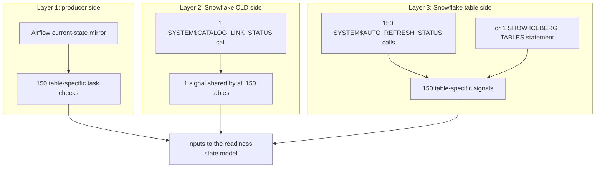

# CLD, Iceberg, and Airflow source signals

A quiet upstream cycle can succeed without changing rows or creating a new
snapshot. Source readiness therefore needs three independent signals: the
producer task, the catalog-linked database (CLD), and the Iceberg table.

## Three-layer flow



## Checks and exact example statements

The example uses CLD database `ICEBERG_PROD`, Snowflake schema `PAYMENTS`, table
`PAYMENT_EVENTS`, and Airflow task `validate_payments_payment_events` with
`map_index = -1`.

<table>
  <thead>
    <tr>
      <th>Layer and scope</th>
      <th>Statement for the example object</th>
      <th>Runs for 150 tables in one CLD</th>
      <th>Healthy result</th>
    </tr>
  </thead>
  <tbody>
    <tr>
      <td>1. Airflow task<br>One table-to-task mapping</td>
      <td>
        <pre><code class="language-sql">select
    dag_id,
    task_id,
    run_id,
    coalesce(map_index, -1) as map_index,
    lower(state) as task_state,
    start_date as started_at,
    end_date as completed_at,
    max(
        case
            when lower(state) = 'success'
                then end_date
        end
    ) over () as last_success_at,
    try_number
from OBSERVABILITY_PROD.AIRFLOW.TASK_INSTANCE
where task_id = 'validate_payments_payment_events'
  and coalesce(map_index, -1) = -1
  and dag_id in (
      'replay_payments_hourly',
      'replay_payments_daily'
  )
  and coalesce(end_date, start_date) &gt;= dateadd(
      'hour',
      -72,
      current_timestamp()
  )
qualify row_number() over (
    order by
        start_date desc,
        coalesce(end_date, start_date) desc,
        coalesce(try_number, 0) desc,
        dag_id desc,
        run_id desc
) = 1;</code></pre>
      </td>
      <td>150 table-specific queries</td>
      <td>The latest row has <code>task_state = 'success'</code>, and <code>last_success_at</code> is no more than 26 hours old.</td>
    </tr>
    <tr>
      <td>2. CLD link<br>Database <code>ICEBERG_PROD</code>, not a schema or remote catalog namespace</td>
      <td>
        <pre><code class="language-sql">select
    system$catalog_link_status(
        'ICEBERG_PROD'
    ) as cld_status;</code></pre>
      </td>
      <td><strong>1 shared call</strong></td>
      <td><code>executionState = RUNNING</code> and <code>failureDetails</code> is empty.</td>
    </tr>
    <tr>
      <td>3. Table auto-refresh<br>One fully qualified Iceberg table</td>
      <td>
        <pre><code class="language-sql">select
    system$auto_refresh_status(
        '"ICEBERG_PROD"."PAYMENTS"."PAYMENT_EVENTS"'
    ) as table_refresh_status;</code></pre>
      </td>
      <td>150 calls with 150 different table names</td>
      <td><code>executionState = RUNNING</code>, the error is blank, and <code>pendingSnapshotCount &lt;= 0</code>.</td>
    </tr>
    <tr>
      <td>3. Table auto-refresh<br>Batch-collection alternative</td>
      <td>
        <pre><code class="language-sql">show iceberg tables in database ICEBERG_PROD
    -&gt;&gt; select
            "database_name" as source_database,
            "schema_name" as source_schema,
            "name" as source_table,
            parse_json(
                "auto_refresh_status"
            ):executionState::varchar as refresh_state,
            parse_json(
                "auto_refresh_status"
            ):invalidExecutionStateReason::varchar as refresh_error,
            try_to_number(
                parse_json(
                    "auto_refresh_status"
                ):pendingSnapshotCount::varchar
            ) as pending_snapshot_count
        from $1
        order by
            source_schema,
            source_table;</code></pre>
      </td>
      <td><strong>1 statement</strong> returning one row per visible table</td>
      <td>Reconcile the returned identifiers to the expected 150-table registry; every expected table must appear and pass the table conditions above.</td>
    </tr>
  </tbody>
</table>

The CLD statement is never repeated per table. The supplied dbt tests execute
150 Airflow queries and 150 table-status calls because those results are
table-specific. A batch collector can replace only the 150 table-status calls
with one `SHOW ICEBERG TABLES` statement. `SHOW` returns only tables visible to
the role, so its output must be reconciled to the expected registry.

## Prerequisites

1. The dbt role has `MONITOR` on the CLD database.
2. `SYSTEM$AUTO_REFRESH_STATUS` requires `OWNERSHIP` on the checked table. The
   batch `SHOW` alternative requires `SELECT` on each table plus a privilege on
   its parent database and schema.
3. `OBSERVABILITY_PROD.AIRFLOW.TASK_INSTANCE` is a current-state mirror with one
   row per `(dag_id, task_id, run_id, map_index)`. An append-only export must be
   reduced to its latest change row first.
4. The mirror includes `dag_id`, `task_id`, `run_id`, `map_index`, `state`,
   `start_date`, `end_date`, and `try_number`.
5. Each quiet table maps to a specific `(task_id, map_index)` whose `success`
   state means that table was evaluated for the expected cycle.

## Configure and run

[`example_sources.yml`](models/example_sources.yml) shows the complete dbt
configuration. Attach `cld_catalog_link_status` to one registration table per
CLD. Attach `iceberg_auto_refresh_status` and `airflow_task_freshness` to every
source table.

```bash
dbt parse
dbt test --select test_name:cld_catalog_link_status --store-failures
dbt test --select test_name:iceberg_auto_refresh_status --store-failures
dbt test --select test_name:airflow_task_freshness --store-failures
```

The generic tests contain the full pass/fail logic:

- [`cld_catalog_link_status.sql`](tests/generic/cld_catalog_link_status.sql)
- [`iceberg_auto_refresh_status.sql`](tests/generic/iceberg_auto_refresh_status.sql)
- [`airflow_task_freshness.sql`](tests/generic/airflow_task_freshness.sql)

Persist the three signals independently and combine them only in the readiness
state model. Retry a transient `ICEBERG_AUTO_REFRESH_PENDING` result within the
delivery window. For a stopped table pipe, follow
[`iceberg_auto_refresh_recovery.md`](iceberg_auto_refresh_recovery.md).

For sources that can publish a completion contract, prefer one completion row
per table and business date, including zero rows written and the Airflow data
interval or run identifier. That removes the time-window inference.
