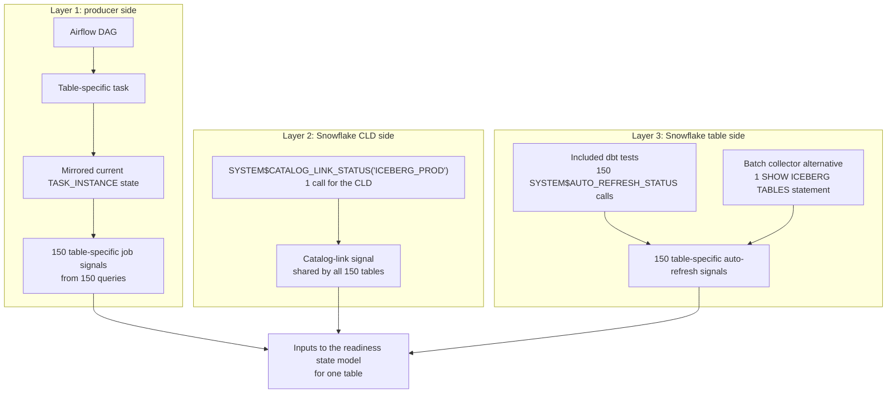

# CLD, Iceberg, and Airflow source signals

A quiet upstream cycle can succeed without changing rows or creating a new
snapshot, so snapshot age is not a reliable processing watermark. Three
independent tests expose the database, table, and job signals needed to evaluate
the source.

## Three-layer flow



The monitoring SQL can run in Snowflake, but the evidence comes from three
different scopes. Airflow supplies producer-side job evidence. The CLD supplies
one shared discovery signal for its configured namespaces. Each Iceberg table
supplies its own auto-refresh signal. The three results stay independent until
the readiness model evaluates one table. “One check per table” describes the
result grain, not necessarily one SQL submission per table: Snowflake can return
the auto-refresh statuses for the registry-listed tables visible to the role in
one `SHOW ICEBERG TABLES` statement. The included dbt generic test uses one
`SYSTEM$AUTO_REFRESH_STATUS` call per table. The fleet statement below is the
batch-collector alternative, not what that generic test compiles to.

| Layer | Test | Signal origin and scope | Result grain | Pass condition | Failure isolated |
|---|---|---|---|---|---|
| 1 | `airflow_task_freshness` | Producer job plane, one table-specific task ID and map index across its allowed DAGs | Table-to-task mapping | The latest task state is `success`, and its most recent successful `end_date` is within `max_success_age_hours` | No task ran in the lookback window, the latest task failed, no successful task exists, or the latest success is stale |
| 2 | `cld_catalog_link_status` | Snowflake data plane, one catalog-linked database (CLD) | CLD | The CLD discovery pipe is `RUNNING` and `failureDetails` is empty across its configured namespace scope | The CLD cannot connect to the external catalog, discover an entity, or complete a supported link operation |
| 3 | `iceberg_auto_refresh_status` | Snowflake data plane, one externally managed Iceberg table | Iceberg table | The table refresh pipe is `RUNNING`, has no execution error, and has no more than the allowed pending snapshots | The table-specific refresh is unavailable, stalled, stopped, invalid, or backlogged even though the CLD can still be healthy |

No test reads or interprets another. A healthy catalog link does not prove that
one table's auto-refresh pipe is running, and Airflow success does not prove that
Snowflake applied the latest snapshot. Instantiate `cld_catalog_link_status`
once per CLD. A dbt generic test must attach to a resource, so designate one
source table as that CLD's registration point; the signal remains CLD-wide.
Attach `iceberg_auto_refresh_status` and `airflow_task_freshness` to every quiet
source table and retain all results independently. For 150 tables in one CLD,
that is one CLD check, 150 table-refresh checks, and 150 task-freshness checks.

| Layer | Included dbt tests for 150 tables in one CLD | Batch alternative shown here |
|---|---|---|
| 1. Airflow task | 150 table-specific current-state queries | Not included |
| 2. CLD link | One shared `SYSTEM$CATALOG_LINK_STATUS` call | The same one call |
| 3. Table refresh | 150 `SYSTEM$AUTO_REFRESH_STATUS` calls with 150 different table names | One `SHOW ICEBERG TABLES` statement returning and reconciling 150 table rows |

The CLD function is not repeated 150 times. Only the signals whose scope is one
table are evaluated 150 times; the batch form can collect the table-refresh
signals in one submission while preserving one result per table.

## Prerequisites

1. The dbt execution role has `MONITOR` on the catalog-linked database.
2. For table status, the role has `OWNERSHIP` on a table checked with
   `SYSTEM$AUTO_REFRESH_STATUS`, or `SELECT` on every table included by the
   `SHOW ICEBERG TABLES` fleet query plus `MONITOR` on the parent database and
   `USAGE` on each parent schema.
3. Airflow task-instance state is mirrored to a relation dbt can read, with one
   current row per `(dag_id, task_id, run_id, map_index)`. For an append-only
   export, expose a view that selects its latest change row before using this
   test.
4. The mirror contains `dag_id`, `task_id`, `run_id`, `map_index`, `state`,
   `start_date`, `end_date`, and `try_number`.
5. Every quiet table maps to a specific `(task_id, map_index)` whose `success`
   state means that table was evaluated for the expected cycle. Use `-1` for an
   unmapped task. A broad DAG success is not sufficient.

## Statements for one table and the fleet

The following statements inspect the same source configured in
[`example_sources.yml`](models/example_sources.yml):

- Snowflake CLD database: `ICEBERG_PROD`
- Iceberg table: `ICEBERG_PROD.PAYMENTS.PAYMENT_EVENTS`
- Airflow history: `OBSERVABILITY_PROD.AIRFLOW.TASK_INSTANCE`
- Table-specific task: `validate_payments_payment_events`
- Airflow map index: `-1` (an unmapped task)
- Allowed DAGs: `replay_payments_hourly` and `replay_payments_daily`
- Thresholds: no pending snapshots, a success within 26 hours, and a 72-hour
  Airflow lookback

### Layer 1: read the producer task

The current task-instance row is the producer-side evidence. Airflow updates
the same row across retries, so `try_number` identifies the current attempt.
This query returns the latest matching task instance across the allowed DAGs.

```sql
select
    dag_id,
    task_id,
    run_id,
    coalesce(map_index, -1) as map_index,
    task_state,
    started_at,
    completed_at,
    try_number
from (
    select
        dag_id,
        task_id,
        run_id,
        map_index,
        lower(state) as task_state,
        start_date as started_at,
        end_date as completed_at,
        try_number
    from OBSERVABILITY_PROD.AIRFLOW.TASK_INSTANCE
    where task_id = 'validate_payments_payment_events'
      and coalesce(map_index, -1) = -1
      and dag_id in (
          'replay_payments_hourly',
          'replay_payments_daily'
      )
      and coalesce(end_date, start_date) >= dateadd(
          'hour',
          -72,
          current_timestamp()
      )
) as task_instances
qualify row_number() over (
    order by
        started_at desc,
        coalesce(completed_at, started_at) desc,
        coalesce(try_number, 0) desc,
        dag_id desc,
        run_id desc,
        coalesce(map_index, -1) desc
) = 1;
```

| Result column | Required value or use |
|---|---|
| `dag_id` | The allowed DAG containing the latest table-specific task; both DAGs do not have to run |
| `task_id` | `validate_payments_payment_events` |
| `run_id`, `map_index` | Airflow identity of the task instance; this example requires map index `-1` |
| `task_state` | `success` |
| `started_at` | Start time used to identify the latest task instance |
| `completed_at` | Must be within the 26-hour success threshold |
| `try_number` | Current attempt number for that task instance |

### Layer 2: read the CLD discovery status

The CLD call is shared by all tables in `ICEBERG_PROD`. Run it once for the
monitoring cycle, not once per table.

```sql
select
    system$catalog_link_status('ICEBERG_PROD') as cld_status;
```

| Result column | Required value or use |
|---|---|
| `cld_status` | JSON payload whose `executionState` is `RUNNING` and whose `failureDetails` array is empty |

### Layer 3: read the table auto-refresh status

For one table, call `SYSTEM$AUTO_REFRESH_STATUS` with its fully qualified name.

```sql
select
    system$auto_refresh_status(
        '"ICEBERG_PROD"."PAYMENTS"."PAYMENT_EVENTS"'
    ) as table_refresh_status;
```

| Result column | Required value or use |
|---|---|
| `table_refresh_status` | JSON payload whose `executionState` is `RUNNING`, whose `invalidExecutionStateReason` is blank, and whose `pendingSnapshotCount` is within the allowed limit |

For a batch collector, query the database's table metadata once and reconcile
the result to the expected table registry. This example uses two inline registry
rows; replace the `VALUES` rows with the 150-row production registry. The left
join is required:
`SHOW ICEBERG TABLES` returns only objects visible to the execution role, and a
missing table must fail instead of disappearing from the result. The statement
proves coverage against the supplied registry; it cannot detect a table omitted
from that registry. A 150-table CLD is below the command's 10,000-row limit.

```sql
show iceberg tables in database ICEBERG_PROD
    ->> with expected_tables as (
            select
                column1::varchar as source_database,
                column2::varchar as source_schema,
                column3::varchar as source_table,
                column4::number as max_pending_snapshots
            from values
                ('ICEBERG_PROD', 'PAYMENTS', 'PAYMENT_EVENTS', 0),
                ('ICEBERG_PROD', 'PAYMENTS', 'SETTLEMENT_STATUS', 0)
        ),
        visible_tables as (
            select
                "database_name" as source_database,
                "schema_name" as source_schema,
                "name" as source_table,
                parse_json("auto_refresh_status") as refresh_status
            from $1
        ),
        evaluated as (
            select
                expected.source_database,
                expected.source_schema,
                expected.source_table,
                status.refresh_status:executionState::varchar
                    as refresh_state,
                status.refresh_status:invalidExecutionStateReason::varchar
                    as refresh_error,
                try_to_number(
                    status.refresh_status:pendingSnapshotCount::varchar
                ) as pending_snapshot_count,
                expected.max_pending_snapshots,
                case
                    when status.source_table is null
                        then 'TABLE_NOT_VISIBLE_OR_MISSING'
                    when status.refresh_status is null
                        then 'ICEBERG_AUTO_REFRESH_STATUS_UNAVAILABLE'
                    when status.refresh_status:executionState::varchar is null
                        then 'ICEBERG_AUTO_REFRESH_STATUS_UNAVAILABLE'
                    when upper(
                        status.refresh_status:executionState::varchar
                    ) != 'RUNNING'
                        then concat(
                            'ICEBERG_AUTO_REFRESH_',
                            upper(
                                status.refresh_status:executionState::varchar
                            )
                        )
                    when nullif(
                        trim(
                            status.refresh_status:invalidExecutionStateReason::varchar
                        ),
                        ''
                    ) is not null
                        then 'ICEBERG_AUTO_REFRESH_ERROR'
                    when coalesce(
                        try_to_number(
                            status.refresh_status:pendingSnapshotCount::varchar
                        ),
                        0
                    ) > expected.max_pending_snapshots
                        then 'ICEBERG_AUTO_REFRESH_PENDING'
                    else null
                end as failure_reason
            from expected_tables as expected
            left join visible_tables as status
                on status.source_database = expected.source_database
               and status.source_schema = expected.source_schema
               and status.source_table = expected.source_table
        )
        select
            iff(failure_reason is null, 'PASS', 'FAIL') as check_status,
            failure_reason,
            source_database,
            source_schema,
            source_table,
            refresh_state,
            refresh_error,
            pending_snapshot_count,
            max_pending_snapshots
        from evaluated
        order by
            source_schema,
            source_table;
```

| Result column | Required value or use |
|---|---|
| `check_status` | `PASS`; the query still emits a `FAIL` row when an expected table is absent from `SHOW` |
| `failure_reason` | `NULL` |
| `source_database`, `source_schema`, `source_table` | Table identifier used to join the status to the readiness registry |
| `refresh_state` | `RUNNING` |
| `refresh_error` | `NULL` or blank |
| `pending_snapshot_count` | At or below `max_pending_snapshots` |
| `max_pending_snapshots` | Per-table threshold from the expected registry |

## Evaluate the three signals

The following diagnostic statements parse those signals and always return one
row with `PASS` or `FAIL`. The dbt tests use the same decisions but return no
rows on a pass so dbt can grade them as generic tests.

### Evaluate the CLD discovery pipe

This is the CLD-wide prerequisite for the example table. `ICEBERG_PROD` is the
Snowflake CLD object, not a remote catalog namespace. The function has no
namespace argument: it evaluates the link across the namespaces configured on
that CLD, and this check fails when `failureDetails` contains an error for any
entity in that scope. It does not prove that the table's own auto-refresh pipe
is healthy.

```sql
with catalog_link_status as (
    select
        parse_json(
            system$catalog_link_status('ICEBERG_PROD')
        ) as link_status
),
catalog_link_signal as (
    select
        link_status:executionState::varchar as link_state,
        link_status:failedExecutionStateReason::varchar
            as failure_reason_detail,
        link_status:failedExecutionStateErrorCode::varchar
            as failure_error_code,
        try_to_timestamp_tz(
            link_status:lastLinkAttemptStartTime::varchar
        ) as last_link_attempt_at,
        coalesce(
            array_size(link_status:failureDetails),
            0
        ) as failure_detail_count,
        link_status:failureDetails as failure_details
    from catalog_link_status
),
evaluated as (
    select
        *,
        case
            when link_state is null
                then 'CLD_LINK_STATUS_UNAVAILABLE'
            when upper(link_state) != 'RUNNING'
                then concat('CLD_LINK_', upper(link_state))
            when failure_detail_count > 0
                then 'CLD_LINK_ENTITY_FAILURES'
            else null
        end as failure_reason
    from catalog_link_signal
)
select
    iff(failure_reason is null, 'PASS', 'FAIL') as check_status,
    failure_reason,
    link_state,
    failure_reason_detail,
    failure_error_code,
    last_link_attempt_at,
    failure_detail_count,
    failure_details
from evaluated;
```

| Result column | Healthy value or use |
|---|---|
| `check_status` | `PASS` |
| `failure_reason` | `NULL` |
| `link_state` | `RUNNING` |
| `failure_reason_detail`, `failure_error_code` | Diagnostic fields; normally `NULL` while the link is healthy |
| `last_link_attempt_at` | Last discovery attempt; returned for diagnosis but not used as a freshness watermark |
| `failure_detail_count` | `0` |
| `failure_details` | Entity-level failures to investigate when the count is greater than zero |

`PASS` means the CLD discovery pipe is `RUNNING` and reports no entity-level
failures. Continue to the table check even when this passes.

### Evaluate the table auto-refresh pipe

This checks the pipe that applies new Iceberg metadata to this table in
Snowflake. The example allows no queued snapshots.

```sql
with auto_refresh_status as (
    select
        parse_json(
            system$auto_refresh_status(
                '"ICEBERG_PROD"."PAYMENTS"."PAYMENT_EVENTS"'
            )
        ) as refresh_status
),
auto_refresh_signal as (
    select
        refresh_status:executionState::varchar as refresh_state,
        refresh_status:invalidExecutionStateReason::varchar as refresh_error,
        try_to_timestamp_tz(
            refresh_status:lastSnapshotTime::varchar
        ) as last_snapshot_at,
        try_to_timestamp_tz(
            refresh_status:lastUpdatedTime::varchar
        ) as last_updated_at,
        coalesce(
            try_to_number(
                refresh_status:pendingSnapshotCount::varchar
            ),
            0
        ) as pending_snapshot_count
    from auto_refresh_status
),
evaluated as (
    select
        *,
        case
            when refresh_state is null
                then 'ICEBERG_AUTO_REFRESH_STATUS_UNAVAILABLE'
            when upper(refresh_state) != 'RUNNING'
                then concat(
                    'ICEBERG_AUTO_REFRESH_',
                    upper(refresh_state)
                )
            when nullif(trim(refresh_error), '') is not null
                then 'ICEBERG_AUTO_REFRESH_ERROR'
            when pending_snapshot_count > 0
                then 'ICEBERG_AUTO_REFRESH_PENDING'
            else null
        end as failure_reason
    from auto_refresh_signal
)
select
    iff(failure_reason is null, 'PASS', 'FAIL') as check_status,
    failure_reason,
    refresh_state,
    refresh_error,
    last_snapshot_at,
    last_updated_at,
    pending_snapshot_count
from evaluated;
```

| Result column | Healthy value or use |
|---|---|
| `check_status` | `PASS` |
| `failure_reason` | `NULL` |
| `refresh_state` | `RUNNING` |
| `refresh_error` | `NULL` or blank |
| `last_snapshot_at` | Snapshot creation time in the external catalog; diagnostic only for a quiet source |
| `last_updated_at` | Time Snowflake applied that snapshot; diagnostic only for a quiet source |
| `pending_snapshot_count` | `0` for this example |

`PASS` means the table pipe is `RUNNING`, has no error, and has applied every
queued snapshot. It does not prove the producer ran for the expected cycle.

### Evaluate the table-specific Airflow task

This checks one table-specific validation task and map index. It evaluates the
latest current-state task instance across the allowed DAGs and the completion
age of the latest successful task.

```sql
with task_runs as (
    select
        dag_id,
        task_id,
        run_id,
        coalesce(map_index, -1) as map_index,
        lower(state) as task_state,
        start_date as started_at,
        end_date as completed_at,
        try_number
    from OBSERVABILITY_PROD.AIRFLOW.TASK_INSTANCE
    where task_id = 'validate_payments_payment_events'
      and coalesce(map_index, -1) = -1
      and dag_id in (
          'replay_payments_hourly',
          'replay_payments_daily'
      )
      and coalesce(end_date, start_date) >= dateadd(
          'hour',
          -72,
          current_timestamp()
      )
),
latest_task as (
    select
        dag_id,
        task_id,
        run_id,
        map_index,
        task_state,
        started_at,
        completed_at,
        try_number
    from task_runs
    qualify row_number() over (
        order by
            started_at desc,
            coalesce(completed_at, started_at) desc,
            coalesce(try_number, 0) desc,
            dag_id desc,
            run_id desc,
            map_index desc
    ) = 1
),
task_summary as (
    select
        count(*) as run_count,
        max(
            case
                when task_state = 'success'
                    then completed_at
            end
        ) as last_success_at
    from task_runs
),
airflow_signal as (
    select
        summary.run_count,
        summary.last_success_at,
        latest.dag_id,
        latest.task_id,
        latest.run_id,
        latest.map_index,
        latest.task_state,
        latest.started_at as latest_started_at,
        latest.completed_at as latest_completed_at,
        datediff(
            'minute',
            summary.last_success_at,
            current_timestamp()
        ) / 60.0 as success_age_hours
    from task_summary as summary
    left join latest_task as latest
        on true
),
evaluated as (
    select
        *,
        case
            when run_count = 0
                then 'NO_AIRFLOW_RUN_IN_LOOKBACK'
            when coalesce(task_state, '') != 'success'
                then concat(
                    'AIRFLOW_TASK_',
                    upper(coalesce(task_state, 'UNKNOWN'))
                )
            when last_success_at is null
                then 'NO_AIRFLOW_SUCCESS_IN_LOOKBACK'
            when success_age_hours > 26
                then 'STALE_AIRFLOW_SUCCESS'
            else null
        end as failure_reason
    from airflow_signal
)
select
    iff(failure_reason is null, 'PASS', 'FAIL') as check_status,
    failure_reason,
    dag_id,
    task_id,
    run_id,
    map_index,
    task_state,
    latest_started_at,
    latest_completed_at,
    last_success_at,
    success_age_hours
from evaluated;
```

| Result column | Healthy value or use |
|---|---|
| `check_status` | `PASS` |
| `failure_reason` | `NULL` |
| `dag_id` | The allowed DAG containing the latest table-specific task; both DAGs do not have to run |
| `task_id` | `validate_payments_payment_events` |
| `run_id`, `map_index` | Airflow identity of the latest task instance |
| `task_state` | `success` |
| `latest_started_at` | Start time of the latest task instance |
| `latest_completed_at` | Completion time of the latest task instance |
| `last_success_at` | Completion time of the latest successful task |
| `success_age_hours` | At most `26` |

`PASS` means the latest table-specific task succeeded and a successful task
completed no more than 26 hours ago. It does not prove that Snowflake discovered
or refreshed the corresponding table.

## Install

1. Copy [`cld_catalog_link_status.sql`](tests/generic/cld_catalog_link_status.sql),
   [`iceberg_auto_refresh_status.sql`](tests/generic/iceberg_auto_refresh_status.sql),
   and [`airflow_task_freshness.sql`](tests/generic/airflow_task_freshness.sql)
   into the dbt project's `tests/generic/` directory.
2. For each CLD, designate one source table as the registration point for
   `cld_catalog_link_status`. Do not repeat the CLD test on every table.
3. Attach the other two tests to each quiet source table. Adapt
   [`example_sources.yml`](models/example_sources.yml) with the Airflow mirror
   relation, table-specific task identifier and map index, allowed DAG
   identifiers, success-age threshold, and allowed Iceberg snapshot backlog.
4. Run and persist failures:

```bash
dbt parse
dbt test --select test_name:cld_catalog_link_status --store-failures
dbt test --select test_name:iceberg_auto_refresh_status --store-failures
dbt test --select test_name:airflow_task_freshness --store-failures
```

Each test returns no rows when its own condition passes. Failures include
`CLD_LINK_ENTITY_FAILURES`, `ICEBERG_AUTO_REFRESH_STOPPED`,
`ICEBERG_AUTO_REFRESH_PENDING`, `AIRFLOW_TASK_FAILED`, and
`STALE_AIRFLOW_SUCCESS`. No failure row mixes signal families.

## Operational use

Run one CLD check per CLD and the two table-level checks for each source before
downstream source-dependent models. Retry a transient
`ICEBERG_AUTO_REFRESH_PENDING` result within the delivery window. For a stopped
table-level pipe, follow
[`iceberg_auto_refresh_recovery.md`](iceberg_auto_refresh_recovery.md). Persist
results and combine them only in the state and alerting layer.

This is a bridge for sources that do not publish a processing watermark. The
stronger contract is one completion row per table and business date, including
zero records written and the Airflow data interval or run identifier. That
removes the time-window inference and distinguishes “processed with no change”
from “the wrong task happened to succeed recently.”
